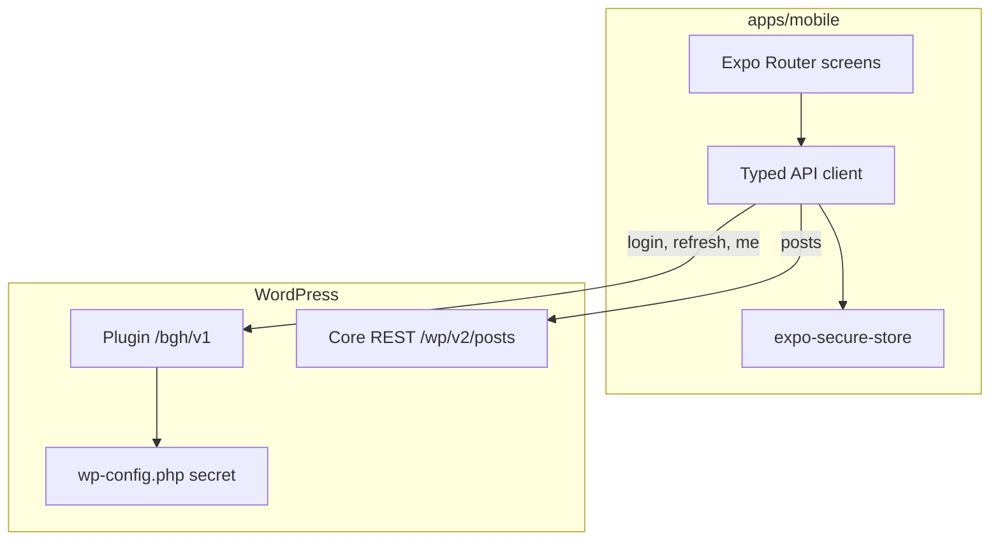

# WP Mobile Client

A React Native app and a WordPress plugin that sign a reader in and show posts from a WordPress site.

The app lives in `apps/mobile`. The plugin lives in `wordpress-plugin`. They used to be separate repositories. The plugin repository was [azra212/wp-mobile-client-plugin](https://github.com/azra212/wp-mobile-client-plugin).

## Architecture



The plugin is the auth boundary: health, login, refresh, and the current user. Published posts stay on the core WordPress REST API (`/wp/v2/posts`). A later write, such as saving a draft, belongs on the plugin with a capability check, not on a core route.

Login returns an access token (15 minutes) and a refresh token (30 days). The app keeps both in `expo-secure-store`. A 401 triggers one refresh and a retry. If that refresh is rejected, the app deletes both tokens and returns to sign-in. Logout does the same on the device. The server does not revoke a refresh token; it stays valid until it expires.

Failures use the WordPress REST error shape: `code`, `message`, and `data.status`.

## Screenshots

Captures are not in the repo yet. Add them at these paths:

| Path | Screen |
| --- | --- |
| `docs/screenshots/login.png` | Sign in |
| `docs/screenshots/posts.png` | Posts |
| `docs/screenshots/post.png` | Post |

## Mobile app

From `apps/mobile`:

```bash
npm ci
npm start
```

Optional environment, also listed in `apps/mobile/.env.example`:

```bash
EXPO_PUBLIC_API_BASE_URL=https://example.com/wp-json
EXPO_PUBLIC_ENABLE_DEBUG=1
```

`EXPO_PUBLIC_API_BASE_URL` defaults to `https://balkangamehub.com/wp-json`. The debug screen stays unreachable unless `EXPO_PUBLIC_ENABLE_DEBUG=1` and the bundle is a dev build.

Checks:

```bash
npm run lint
npm run typecheck
npm test
```

## WordPress plugin

1. Copy `wordpress-plugin` to `wp-content/plugins/wp-mobile-client`.
2. Activate **WP Mobile Client**.
3. In `wp-config.php`, above the line that says to stop editing, set a long random secret:

```php
define( 'WP_MOBILE_CLIENT_JWT_SECRET', 'replace-with-at-least-32-random-characters' );
```

`JWT_AUTH_SECRET_KEY` is still accepted when the new constant is not set. If neither constant is a non-empty string, token routes return HTTP 500 and the rest of the site stays up.

Routes, under `/wp-json`:

| Method | Path | Who |
| --- | --- | --- |
| `GET` | `/bgh/v1/health` | Public |
| `POST` | `/bgh/v1/login` | Public. Five failures for the same IP and username return HTTP 429 for 15 minutes. |
| `POST` | `/bgh/v1/refresh` | A valid refresh token |
| `GET` | `/bgh/v1/me` | A valid access token, sent as `Authorization: Bearer` |

From `wordpress-plugin`:

```bash
composer install
composer phpcs
```

## Repository layout

```text
apps/mobile/          Expo app
wordpress-plugin/     WordPress plugin
.github/workflows/    Lint, typecheck, unit tests, and PHPCS
```
